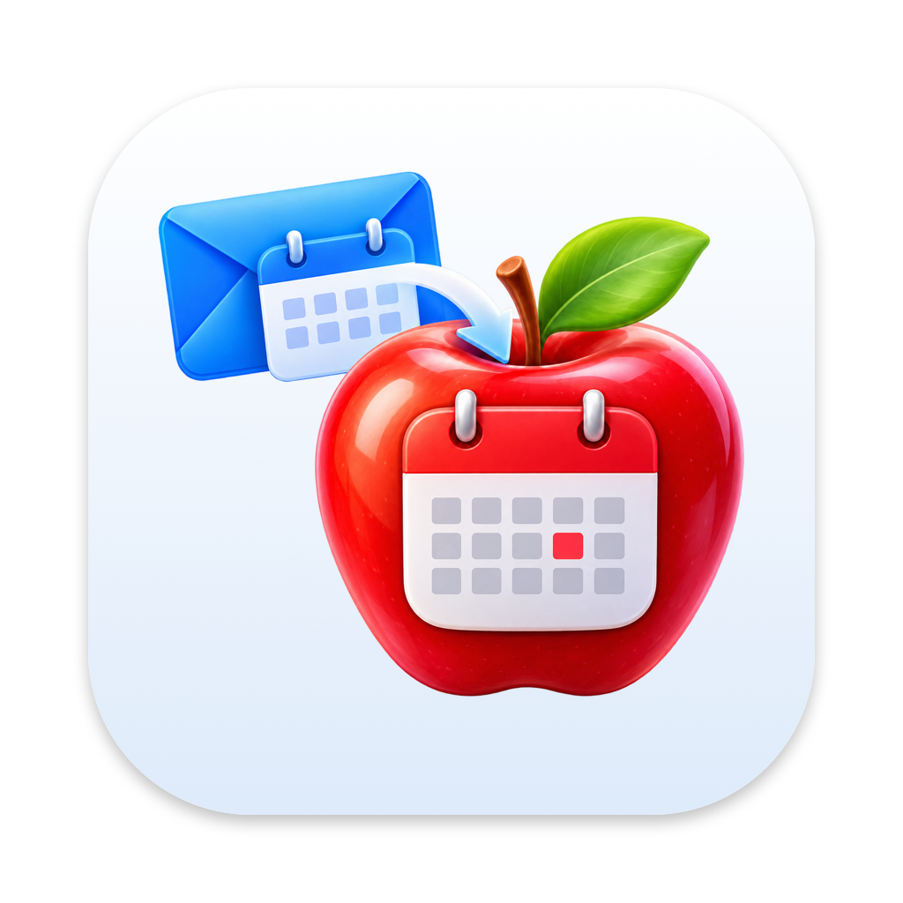

<p align="center"></p>

<h1 align="center">AppleLook</h1>

<p align="center">Copy your Outlook work calendar into an iCloud calendar you can share with family.</p>

<p align="center">
  <a href="https://github.com/michaellorendiaz/AppleLook/releases/latest/download/AppleLook.zip"></a>
  <a href="#linux-server-applelook-server"></a>
</p>

<p align="center">
  <a href="https://github.com/michaellorendiaz/AppleLook/releases/latest"></a>
  
  
  
  <a href="LICENSE"></a>
  <a href="https://buymeacoffee.com/michaellorendiaz"></a>
</p>

> **Never used GitHub?** On a Mac, click the green **Download AppleLook** button above, then follow [Install the Mac app](#install-the-mac-app). You don't need a GitHub account.

AppleLook copies your Outlook work calendar into an iCloud calendar you can share with your family. While Outlook can publish your calendar as a link that Apple Calendar can subscribe to, the calendar can't be shared through iCloud this way and it gives no flexibility to how events are displayed. AppleLook creates a shareable iCloud calendar, keeps it up to date every 15 minutes, and allows you to choose what your family sees: meeting titles, "Busy", or a label of your own.

It works from Outlook's published calendar link alone, so it never signs in to your Microsoft account and cannot edit your Outlook calendar directly. It only edits events it creates in Apple Calendar.

It comes in two versions. Use one or the other for a calendar, not both.

| | Mac version (menu-bar app) | Linux server (AppleLook Server) |
|---|---|---|
| Runs on | A Mac with macOS 14 or later | Any always-on Linux machine with Docker, or Home Assistant |
| Syncs | Every 15 minutes while your Mac is awake | Every 15 minutes, around the clock |
| Set up in | A settings window | A web page on your home network |
| iCloud sign-in | Uses your Mac's iCloud account | Needs an Apple app-specific password |
| Install | [Mac version](#mac-version-menu-bar-app) | [Linux server](#linux-server-applelook-server) |

> **Early preview.** Both versions only ever change events they added themselves, so they can't damage your own calendar events.

## Get your Outlook calendar link

Both versions start from this link.

1. Open [Outlook on the web](https://outlook.office.com/calendar) and sign in.
2. Click the gear (Settings) → **Calendar** → **Shared calendars**.
3. Under **Publish a calendar**, choose your calendar and **Can view all details**, then click **Publish**.
4. Copy the **ICS** link. (If you copy the HTML link by mistake, AppleLook fixes it for you.)

> Treat this link like a password: anyone who has it can see your calendar. If it ever leaks, click **Reset links** on the same screen and paste the new link into AppleLook.

## Event titles

The Mac app and the server name events the same way. **Event title** is a template: `{label}` is your label and `{event}` is the meeting's title, and you can type anything around them.

| Event title | A meeting called "Budget review" shows as |
|---|---|
| `{label}` | Work |
| `{label} ({event})` | Work (Budget review) |
| `{label}: {event}` | Work: Budget review |
| `{event}` | Budget review |
| *(empty)* | Busy |

**Show the label** and **Show meeting titles** add or remove `{label}` and `{event}` for you. If a variable is empty, it's taken out along with any brackets or separators left around it, so `{label} ({event})` with no label gives just "Budget review".

**Alternate Event Titles** (under **Advanced**): meetings whose title contains a keyword get an alternative label, and optionally their own event title, where `{altlabel}` is the alternative label. For example, keyword `ART` and alternative label `Teaching` turn "ART 120 Drawing" into "Teaching (ART 120 Drawing)" while other meetings stay "Work (…)". The keyword has to match the exact word, capitalization included, and a number may follow it: `ART` matches "ART 120", "ART123" and "Critique (ART 209)", but not "Art show", "PARTY" or "ARTS". Separate several keywords with commas.

Settings saved by an older version keep the titles they had.

## Mac version (menu-bar app)

### What you need

- A Mac running macOS 14 (Sonoma) or later, signed in to iCloud with **Calendars** turned on (System Settings → your name → iCloud → Calendars).
- Your [Outlook calendar link](#get-your-outlook-calendar-link).

### Install the Mac app

1. Click the green **Download AppleLook** button at the top of this page. Open **AppleLook.zip** from your Downloads folder to unzip it.
2. Drag **AppleLook** into your **Applications** folder, then double-click it.
3. The first time, macOS says it can't verify the app. That's because AppleLook isn't registered with Apple yet. Click **Done**, then:
   - Open **System Settings → Privacy & Security**.
   - Scroll down to the message about AppleLook and click **Open Anyway**, then enter your Mac password.
   - Click **Open** when asked again.

You only do this once.

### Set it up

A settings window opens the first time:

1. Paste your Outlook link.
2. Click **Allow Calendar Access**, then **Allow** in the message that appears.
3. Choose the calendar to copy into, or type a name and click **Create New Calendar**. A separate calendar is best.
4. Choose what others will see: a label (like "Work"), the [event title](#event-titles), locations, and whether to include meetings marked Tentative or Free.
5. Click **Preview** to check, then **Save and Sync**.

Your meetings appear in that calendar within a minute. To share it, open Calendar, right-click the calendar in the sidebar, and choose **Share Calendar**.

AppleLook now lives in the menu bar (a calendar icon) and starts when you log in. Click the icon to sync right away or change settings.

### Good to know

- **Your Mac has to be awake** to sync. Changes made while it's asleep or off show up shortly after it wakes.
- **Outlook is the source.** If you delete a copied event in iCloud, it comes back on the next sync. Change or decline it in Outlook instead.
- **Which meetings are copied:** busy and out-of-office time from 7 days ago to 90 days ahead, plus, if you turn them on in Settings, meetings marked Tentative or Free. Cancelled meetings are always skipped.
- **How AppleLook recognizes its own events:** each one has a link starting with `applelook://` in its details. Events without that link are never touched.
- **The log** is at `~/Library/Logs/AppleLook.log`.

### Updating

AppleLook checks for new versions once a day. When one is out, **Update Available** appears at the top of its menu. You can also click the menu-bar icon → **Check for Updates…** at any time.

To update:

1. Click **Download** in the update message (or the green button above).
2. Click the menu-bar icon → **Quit AppleLook**.
3. Open the downloaded **AppleLook.zip** and drag the new **AppleLook** into **Applications**, choosing **Replace**.
4. Open AppleLook. As on the first install, macOS asks you to confirm it in **System Settings → Privacy & Security → Open Anyway**.

Your settings (Outlook link, calendar and options) are kept.

On GitHub, you can also click **Watch → Custom → Releases** at the top of this page to get an email for each new version.

### Removing the Mac app

1. Click the menu-bar icon → **Settings…** → **Remove AppleLook Events…** to delete the copies.
2. Click the icon → **Quit AppleLook**.
3. Drag AppleLook from Applications to the Trash.

### Troubleshooting

**"Outlook says the calendar link no longer works"**: the link was reset or unpublished. Publish again, copy the new ICS link, and paste it in Settings.

**"AppleLook isn't allowed to use your calendars"**: open System Settings → Privacy & Security → Calendars and turn AppleLook on (choose Full Access).

**My iCloud calendars aren't in the list**: check that iCloud Calendars is on for this Mac (System Settings → your name → iCloud).

**Times are off**: tell us which time zone your Outlook calendar uses. Outlook writes Windows time zone names, and AppleLook converts them; an unknown one is noted in the log.

## Linux server (AppleLook Server)

AppleLook Server does the same job from a Docker container on a machine that's always on, such as a home server, NAS or Raspberry Pi. It keeps your family's calendar current while your laptop is closed, and you change its settings from a web page.

### What you need

- An always-on Linux machine (64-bit Intel/AMD or ARM, such as a Raspberry Pi 4 or 5) with [Docker Engine and the Compose plugin](https://docs.docker.com/engine/install/).
- Your [Outlook calendar link](#get-your-outlook-calendar-link).
- Your Apple ID and an **app-specific password**: go to [account.apple.com](https://account.apple.com) → **Sign-In and Security** → **App-Specific Passwords** and create one named "AppleLook Server". A server can't use a Mac's iCloud sign-in, so it needs this password to reach iCloud Calendar. You can revoke it there at any time.
- An iCloud calendar to copy into. You can create one from the settings page, or in Calendar on your Mac or iPhone.

### Install the server

1. Make a folder for it, such as `~/applelook`, and in it create a file named `docker-compose.yml` with your own login password for the settings page and your time zone:

   ```yaml
   services:
     applelook:
       image: ghcr.io/michaellorendiaz/applelook:latest
       container_name: applelook
       restart: unless-stopped
       ports:
         - "8080:8080"
       environment:
         APPLELOOK_PASSWORD: "a-long-password-you-choose"
         TZ: "America/New_York"
       volumes:
         - applelook-data:/data

   volumes:
     applelook-data:
   ```

   The page listens on port 8080. If something else on the machine already uses 8080, change the left number, like `"8090:8080"`.

2. Start it from that folder:

   ```bash
   docker compose up -d
   ```

3. Check that it's running. This should print `ok`:

   ```bash
   curl -s http://localhost:8080/health
   ```

   (Use your port if you changed it.)

### Set up the server

1. From any computer on your home network, open `http://<server-address>:8080` (for example `http://192.168.1.20:8080`) and log in with the password from step 1.
2. Paste your Outlook link, your Apple ID and the app-specific password.
3. Choose the iCloud calendar to copy into, or create a new one from the page.
4. Choose what others will see: a label, the [event title](#event-titles), locations, and whether to include meetings marked Tentative or Free.
5. Click **Preview** to check what would be added. It saves nothing. Then click **Save and Sync**.

From then on it syncs at :00, :15, :30 and :45. Share the calendar from Calendar on your Mac or iPhone, the same as with the Mac version.

> Keep the page on your home network. Don't forward its port from your router: the page holds your calendar link and iCloud password.

### Updating the server

From the folder with your `docker-compose.yml`:

```bash
docker compose pull
docker compose up -d
```

Your settings and password are kept in the `applelook-data` Docker volume.

### Removing the server

1. On the settings page, click **Remove Events…** to delete the copies from your calendar.
2. Stop the container and delete its saved settings: `docker compose down -v`.
3. Revoke the app-specific password at [account.apple.com](https://account.apple.com).

### Server notes

- **Logs:** `docker logs applelook`. Each sync logs a line like `sync ok: ... created=0 updated=0 deleted=0`.
- **Home Assistant:** on Home Assistant OS or Supervised, AppleLook Server can also run as an add-on opened from the sidebar, behind Home Assistant's login. See [the server README](server/#option-1-home-assistant-add-on).
- **Don't run both versions into one calendar.** Point the Mac app and the server at different calendars, or your family sees every meeting twice.

## For developers

AppleLook is a Swift package with three parts:

| Target | What it is |
|---|---|
| `AppleLookCore` | Reads .ics feeds (including Outlook's Windows time zone names), expands repeating meetings, applies the filters, and plans each sync. No EventKit or UI, fully unit-tested. |
| `AppleLook` | The menu-bar app. Writes through EventKit, so it uses the Mac's own iCloud account: no app-specific password. |
| `applelook-cli` | `swift run applelook-cli check-feed <link-or-file>` lists what would be copied, without touching any calendar. |

```bash
scripts/test.sh        # unit tests (works with just the Command Line Tools)
scripts/build-app.sh   # build/AppleLook.app and build/AppleLook.zip (Apple Silicon + Intel)
```

Builds are signed with a self-signed certificate (`scripts/make-signing-cert.sh` creates it once) so that macOS keeps users' Calendar permission across updates. To publish a release, bump `CFBundleShortVersionString` in `Resources/Info.plist`, build, and attach `build/AppleLook.zip` to a GitHub Release tagged `v<version>`. The download button and the in-app update check both follow the latest release.

AppleLook Server lives in [`server/`](server/): a Python package (Flask page plus the sync engine from outlook-icloud-bridge) with its own unit tests (`python -m unittest discover tests` in `server/`). The Home Assistant add-on wrapper is in [`home-assistant-addon/`](home-assistant-addon/). Bump the server's version in `server/pyproject.toml`, `server/applelook_server/__init__.py` and `home-assistant-addon/config.yaml` together.

AppleLook grew out of [outlook-icloud-bridge](https://github.com/michaellorendiaz/outlook-icloud-bridge), a Python script that does the same job from the command line. The feed logic matches it event for event.

## License

MIT

AppleLook is free. If it saves your family some "are you in a meeting?" texts, you can [buy me a coffee](https://buymeacoffee.com/michaellorendiaz).
